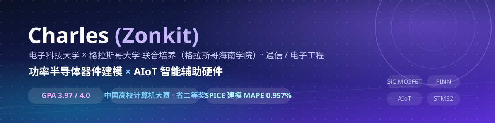
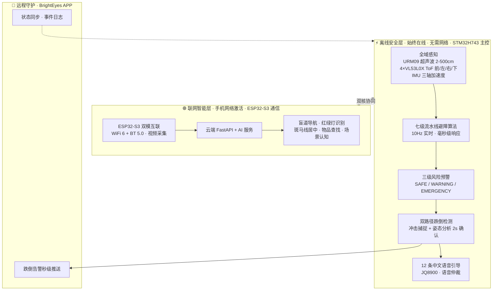

  

 

<h2 align="center">你好，我是 Charles（Zonkit）👋</h2>

  <em>电子科技大学 × 格拉斯哥大学 联合培养（格拉斯哥海南学院）· 通信 / 电子工程</em>

  专注 <b>功率半导体器件建模（SiC MOSFET SPICE）</b> 与 <b>AIoT 智能辅助硬件</b> 的科研与工程实践—— 
  一个能从器件物理做到智能硬件的全栈实践者：既能做 TCAD 仿真与机器学习建模，也能写 STM32 固件与 AI 服务。

  
  
  
  

---

## 🧭 关于我

| |  |
|---|--|
| 🎓 **教育背景** | 电子科技大学 × 格拉斯哥大学 联合培养（格拉斯哥海南学院）· 通信 / 电子工程（两校三区） |
| 📚 **学术表现** | 本科 GPA **3.97 / 4.0** |
| 🔬 **研究兴趣** | 功率半导体器件建模与仿真 · 物理信息神经网络（PINN）· AIoT 智能硬件 · 计算机视觉 · 嵌入式系统 |
| 🏆 **代表性荣誉** | 中国高校计算机大赛 **海南省二等奖** |
| 👥 **学生工作** | 新生导生 · 讲师团团长 · 多个社团负责人 |

---

## 🚀 重点项目

### ① 明眸 BrightEyes AI 全域智能导盲眼镜 —— 双核异构 · 双模架构

> **离线安全保障 + AI 智能增强**，让视障者安全出行，看见世界的光。
> 团队项目（成员：胡俊杰、许彦宸、陈德银 · 指导教师：张辽 · 电子科技大学格拉斯哥海南学院）。
> 本项目为本人独立整理、开发与维护的完整版本，以本账号下的仓库为准，与任何外部同名或相似项目相互独立。

**🎯 项目做了什么**：一款基于多传感器融合感知的穿戴式导盲眼镜——**STM32H743 主控 + ESP32-S3 通信双核异构**、**离线安全层与联网智能层双模协同**：离线层提供 360° 全域感知与本地避障闭环（无需网络、毫秒级响应），联网层接入云端 AI 实现视觉理解与场景认知，BrightEyes APP 构成家属远程守护闭环。

| 维度 | 内容 |
|------|------|
| 🧑‍💻 **我的工作** | 双核异构系统总体架构设计；**STM32H743 离线安全层从零开发**（传感器驱动、七级流水线避障算法、三级风险预警、双路径跌倒检测、语音仲裁）；ESP32-S3 与云端 AI 服务集成；软硬件协同联调与四场景实机验证（城市道路 / 路口斑马线 / 台阶跌落 / 居家室内） |
| 🧭 **工作领域** | AIoT 智能硬件 · 嵌入式系统 · 多传感器融合 · 计算机视觉 · 语音交互 |
| 🎓 **学到了什么** | STM32H743 HAL 驱动与多传感器融合（超声波 + ToF + IMU）；ESP32-S3 WiFi6 / BT 双模通信；七级流水线避障算法与优先级语音仲裁；双路径跌倒检测（冲击捕捉 + 姿态分析）；YOLO 视觉识别与云端 AI 集成；软硬解耦与双核协同设计 |
| 🧰 **使用工具** | STM32H743 · ESP32-S3 · URM09 · VL53L0X · IMU · JQ8900 · Python / FastAPI · PyTorch / YOLO · OpenCV / MediaPipe · CMake |
| 🏆 **主要成果** | 中国高校计算机大赛 **海南省二等奖**；**双模架构**完整原型（离线安全层 + 联网智能层 + APP 守护闭环）；360° 无盲区感知、七级流水线 10Hz 毫秒级响应、双路径跌倒检测 0 误报、12 条标准化中文语音；四场景实机验证 |

  
  

---

### ② PINN-SiC-MOSFET —— 大创项目：PINN 驱动的 SiC MOSFET SPICE 参数提取

> 面向 **1.2 kV 4H-SiC 垂直 DMOSFET** 功率器件，利用**物理信息神经网络（PINN）** 从 Silvaco TCAD 仿真数据中**自动提取 SPICE Level-3 紧凑模型物理参数**，输出可直接用于电路仿真的标准 SPICE `.SUBCKT / .MODEL` 文件。

| 维度 | 内容 |
|------|------|
| 🎯 **项目做了什么** | 将 PINN 引入 SPICE 紧凑模型参数逆向提取：用可微分的 SPICE Level-3 物理模型（13 个物理参数）承载器件物理，用神经网络残差修正与 TCAD 数据的偏差，一次训练得到物理可解释、全工作范围（V_GS∈[0,20]V · V_DS∈[0,1200]V · T∈[298,448]K）可用的 SPICE 模型 |
| 🧑‍💻 **我的工作** | 独立完成大创项目全流程：文献调研（2021–2026 SiC 建模 / PINN 参数提取方向）→ 技术方案设计（物理残差架构）→ Silvaco TCAD 仿真数据生成 → PINN 模型实现与训练（PyTorch）→ 物理参数提取与 SPICE 生成 → 多仿真器精度验证与迭代优化 |
| 🧭 **工作领域** | 功率半导体器件建模与仿真 · 物理信息机器学习 · 电路仿真与模型提取 |
| 🎓 **学到了什么** | 4H-SiC 器件物理（阈值电压、迁移率退化、载流子饱和、DIBL、温度特性）；SPICE Level-3 紧凑模型理论；PINN 工程实现（物理残差、单调性约束、亚阈值专项损失、分离学习率）；Silvaco TCAD 仿真流程；模型验证方法论（Gummel 对称性测试、分区域 / 分温度 MAPE 评估） |
| 🧰 **使用工具** | Python · PyTorch · Silvaco TCAD · LTspice · ngspice · HSPICE · MATLAB |
| 🏆 **主要成果** | 整体 MAPE **0.957%**（目标 < 3%，超越 **3.1×**）；R² = **0.99904**；**13 个物理参数**自动提取；Gummel 对称性误差 **0.67%**（通过）；SPICE 模型兼容 LTspice / ngspice / HSPICE；大创项目结题 |

  

---

## 🛠️ 技术栈

| 领域 | 技术 |
|------|------|
| 器件建模与仿真 |      |
| AI 与后端 |     |
| 嵌入式 |     |
| 工具链 |    |

---

## 📬 联系

  
  

  欢迎交流<b>功率半导体建模、AIoT 硬件与开源项目合作</b> 🚀

